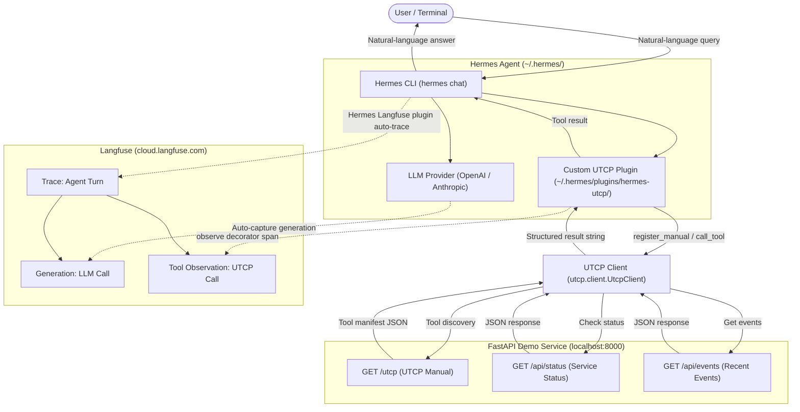
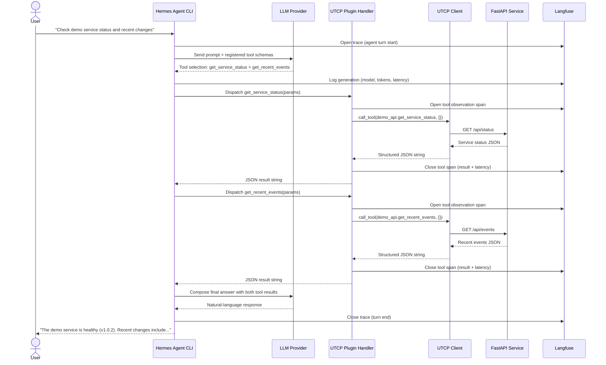

# PROJECT_PLAN.md
# MiniOps – Tool-Calling AI Assistant

> **Status:** Planning Complete — Awaiting Implementation Approval  
> **Version:** 1.0  
> **Date:** 2026-11-08  
> **Author:** Senior AI/ML + Backend Architect (Planning Review)

---

## Table of Contents

1. [Project Overview](#1-project-overview)
2. [Problem Statement and POC Objectives](#2-problem-statement-and-poc-objectives)
3. [Functional Requirements](#3-functional-requirements)
4. [Non-Functional Requirements](#4-non-functional-requirements)
5. [Technology Responsibilities](#5-technology-responsibilities)
6. [Verified Dependency and Version Recommendations](#6-verified-dependency-and-version-recommendations)
7. [Technical Integration Findings](#7-technical-integration-findings)
8. [System Architecture Diagram](#8-system-architecture-diagram)
9. [Sequence Diagram](#9-sequence-diagram)
10. [Detailed Request Execution Flow](#10-detailed-request-execution-flow)
11. [UTCP Tool Manual Design](#11-utcp-tool-manual-design)
12. [Hermes Custom Plugin Design](#12-hermes-custom-plugin-design)
13. [Langfuse Observability Design](#13-langfuse-observability-design)
14. [Recommended Repository Structure](#14-recommended-repository-structure)
15. [File-by-File Implementation Responsibilities](#15-file-by-file-implementation-responsibilities)
16. [Environment Variables and Configuration](#16-environment-variables-and-configuration)
17. [Dependency Installation Plan](#17-dependency-installation-plan)
18. [Step-by-Step Implementation Roadmap](#18-step-by-step-implementation-roadmap)
19. [Unit and Integration Test Strategy](#19-unit-and-integration-test-strategy)
20. [End-to-End Validation Scenarios](#20-end-to-end-validation-scenarios)
21. [Acceptance Criteria](#21-acceptance-criteria)
22. [Potential Technical Risks and Solutions](#22-potential-technical-risks-and-solutions)
23. [Expected Demonstration Flow](#23-expected-demonstration-flow)
24. [Future Enhancements](#24-future-enhancements)
25. [Implementation Task Breakdown](#25-implementation-task-breakdown)

---

## 1. Project Overview

**Project Name:** MiniOps – Tool-Calling AI Assistant  
**Classification:** Experimental Proof of Concept (POC)  
**Primary Goal:** Demonstrate the integration of three technologies — Hermes Agent (Nous Research), UTCP (Universal Tool Calling Protocol), and Langfuse — in a minimal, locally executable agentic application.

The POC connects a conversational AI agent to real API endpoints through a standardised tool-discovery protocol and makes the entire execution chain observable in a tracing dashboard, using only a small FastAPI service and a custom Hermes plugin as the operational layer.

---

## 2. Problem Statement and POC Objectives

### Problem Statement

Modern agentic AI systems require three critical capabilities:

1. **Tool Orchestration** — The agent must be able to discover, select, and invoke external tools based on natural-language intent.
2. **Standardised Tool Contracts** — Tool definitions should follow a consistent, provider-agnostic schema so that different agents and clients can discover and call the same tools without custom glue code per integration.
3. **Observability** — Every LLM generation, tool call, latency, and token expenditure must be traceable so that engineers can audit, debug, and cost-analyse the agent's behaviour.

### POC Objectives

- Verify that Hermes Agent's plugin system supports custom tool registration adequate for a UTCP bridge.
- Verify that UTCP's Python client correctly discovers tools from a FastAPI-hosted manual and invokes them.
- Verify that Langfuse captures the full Hermes execution lifecycle including custom tool observations.
- Produce a minimal, working end-to-end demonstration that a developer can run locally on a single machine.

---

## 3. Functional Requirements

| ID | Requirement |
|----|-------------|
| FR-01 | The user must be able to send a natural-language query through the Hermes Agent CLI. |
| FR-02 | Hermes Agent must identify which tool(s) are needed to satisfy the query. |
| FR-03 | The UTCP plugin must discover available tools from the FastAPI-hosted manual. |
| FR-04 | The UTCP client must invoke the correct FastAPI endpoint(s) based on tool selection. |
| FR-05 | Hermes Agent must receive and process the structured API responses. |
| FR-06 | Hermes Agent must produce a coherent natural-language response from the tool results. |
| FR-07 | The FastAPI service must expose `GET /api/status` returning service health data. |
| FR-08 | The FastAPI service must expose `GET /api/events` returning recent application events. |
| FR-09 | The FastAPI service must expose `GET /utcp` returning a valid UTCP manual. |
| FR-10 | Langfuse must capture the complete agent execution trace including tool observations. |
| FR-11 | The agent must handle API errors gracefully and report them to the user. |
| FR-12 | The agent must respond sensibly to queries that require no tools. |

---

## 4. Non-Functional Requirements

| ID | Requirement |
|----|-------------|
| NFR-01 | The entire stack must run on a single local development machine without external infrastructure beyond the LLM provider API and Langfuse cloud account. |
| NFR-02 | Python 3.11 is the target runtime (required by Hermes Agent's official installer). |
| NFR-03 | No production security controls, authentication, or encryption are required for this POC. |
| NFR-04 | Mock data is acceptable for the FastAPI endpoints; real database or external API calls are out of scope. |
| NFR-05 | The FastAPI service must start within 3 seconds on a development machine. |
| NFR-06 | Each agent interaction must complete within 30 seconds (network-bound by LLM API). |
| NFR-07 | Traces must appear in Langfuse within 10 seconds of interaction completion. |
| NFR-08 | The codebase must be self-contained and reproducible from `requirements.txt`. |

---

## 5. Technology Responsibilities

### 5.1 Hermes Agent

| Responsibility | Detail |
|---|---|
| User interface | Provides the CLI (`hermes chat`) for user interaction |
| Intent understanding | Routes natural-language queries to appropriate tool calls via the configured LLM |
| Plugin loading | Discovers and loads the custom UTCP plugin from `~/.hermes/plugins/` |
| Tool registration | Accepts `ctx.register_tool()` calls from the plugin `register(ctx)` function |
| Tool dispatch | Invokes registered Python handlers when the LLM selects a tool |
| Response generation | Synthesises the final natural-language answer from tool outputs |
| Observability hook | Emits Langfuse traces via the native Langfuse plugin |

### 5.2 UTCP

| Responsibility | Detail |
|---|---|
| Tool definition | Declares `get_service_status` and `get_recent_events` in a JSON manual |
| Manual hosting | FastAPI serves the manual at `GET /utcp` |
| Tool discovery | `UtcpClient.register_manual()` fetches the manual and parses available tools |
| Tool invocation | `UtcpClient.call_tool()` sends the HTTP request to the correct FastAPI endpoint |
| Response delivery | Returns the structured JSON response to the calling handler |

### 5.3 Langfuse

| Responsibility | Detail |
|---|---|
| Agent tracing | Captures each Hermes conversation turn as a root trace |
| LLM generation capture | Logs model, tokens, latency, and cost per generation |
| Tool observation | Captures custom UTCP tool call inputs/outputs via `@observe(as_type="tool")` |
| Dashboard | Provides the Langfuse web UI for trace inspection |

---

## 6. Verified Dependency and Version Recommendations

> [!IMPORTANT]
> The following versions have been verified against official package repositories and documentation as of November 2026. Pin these versions in `requirements.txt`.

### 6.1 Runtime

| Component | Version | Notes |
|---|---|---|
| Python | 3.11.x | Required by Hermes Agent official installer |
| pip | Latest | Upgraded before package installation |

### 6.2 Hermes Agent

| Item | Detail |
|---|---|
| Distribution | Shell installer — not a standard PyPI wheel |
| Install command | `curl -fsSL https://hermes-agent.nousresearch.com/install.sh \| bash` |
| Installs | `uv`, Python 3.11, Node.js, Hermes runtime under `~/.hermes/` |
| Plugin directory | `~/.hermes/plugins/<plugin-name>/` |
| Langfuse plugin | `hermes plugins install langfuse` (bundled plugin catalog) |
| Docs | https://nousresearch.com / https://github.com/NousResearch/hermes-agent |

### 6.3 UTCP Python Client

| Package | Install | Notes |
|---|---|---|
| `utcp` | `pip install utcp` | Core client and types (current: v1.2.0) |
| `utcp-http` | `pip install utcp-http` | HTTP transport provider |

> [!WARNING]
> UTCP v1.0.0 (released August 2025) was a **major breaking rewrite** from v0.x. All class names, import paths, and config keys below reflect v1.0+. Do not use pre-v1.0 tutorials or examples.

**Key classes (verified from PyPI, utcp.io, and GitHub `python-utcp`):**

| Class / Method | Module | Description |
|---|---|---|
| `UtcpClient` | `utcp.client.utcp_client` | Main async client |
| `UtcpClient.create()` | async classmethod | Initialise client instance — must be awaited |
| `client.register_manual(provider)` | async method | Register an `HttpProvider`; returns list of discovered `Tool` objects |
| `client.call_tool(tool_name, arguments)` | async method | Execute a registered tool by namespaced name |
| `client.list_tools()` | async method | List all registered tools |
| `HttpProvider` | `utcp.shared.provider` | HTTP provider configuration model |
| `ToolCallError` | `utcp.exceptions` | Raised on tool execution failure |
| `ToolNotFoundError` | `utcp.exceptions` | Raised when tool name cannot be resolved |
| `AuthenticationError` | `utcp.exceptions` | Auth-related failures |

**`HttpProvider` constructor fields (verified):**

```python
from utcp.shared.provider import HttpProvider

HttpProvider(
    name="demo_api",                    # str, required — becomes the namespace prefix
    provider_type="http",               # str, required — must be "http"
    url="http://localhost:8000/utcp",   # str, required — URL to the UTCP manual
    http_method="GET",                  # str, optional — default "GET"
    auth=None,                          # dict, optional — auth config
    headers=None,                       # dict, optional — static request headers
)
```

**Tool name format:** `<provider_name>.<tool_name>` — e.g., `demo_api.get_service_status`

**`call_tool` signature:**

```python
result = await client.call_tool(
    tool_name="demo_api.get_service_status",  # namespaced name
    arguments={}                              # dict of input params
)
```

> [!NOTE]
> The parameter name is `arguments` (not `tool_args`). Some older documentation incorrectly uses `tool_args`. Verify against the installed package version before use.

### 6.4 FastAPI Stack

| Package | Recommended Version | Notes |
|---|---|---|
| `fastapi` | `0.111.0` (already installed) | REST framework |
| `pydantic` | `2.7.2` (already installed) | Response validation |
| `uvicorn[standard]` | `>=0.29.0` | ASGI server |

### 6.5 Langfuse

| Package | Install | Notes |
|---|---|---|
| `langfuse` | `pip install langfuse` | Python SDK v3+ (OTel-based); current ~v5.x |

> [!WARNING]
> The legacy `langfuse.trace()`, `langfuse.span()`, and `langfuse.generation()` builder methods from SDK **v2 are removed in v3+/v5**. This plan uses only the modern v3+ API. Do not reference v2 tutorials.

**Key SDK 3.x/v5 API (verified):**

| Element | Description |
|---|---|
| `get_client()` | Returns the global `Langfuse` client singleton (reads env vars automatically) |
| `@observe(name=..., as_type=...)` | Decorator that wraps a function as a named span/observation; supports both sync and async functions |
| `langfuse.start_as_current_observation(as_type="generation", ...)` | Context manager for a generation span with model/token data |
| `observation.update(output=..., usage_details=...)` | Enrich an open span with result data |
| `langfuse.update_current_span(output=...)` | Update the current active span from anywhere in the call stack |
| `langfuse.update_current_trace(user_id=..., session_id=..., tags=...)` | Update the root trace metadata |
| `langfuse.flush()` | Flush buffered events (keeps client alive) |
| `langfuse.shutdown()` | Final flush + stop background worker threads (use at process exit) |

**`usage_details` key format for `observation.update()`:**
```python
usage_details={
    "input_tokens": 120,
    "output_tokens": 45,
    "total_tokens": 165,
    # Optional:
    "cache_read_input_tokens": 30,
    "output_reasoning_tokens": 10,
}
```

**`@observe` decorator signature:**
```python
from langfuse.decorators import observe

@observe(
    name="optional-override-name",   # defaults to function name
    as_type="span",                  # "span" (default) or "generation"
    capture_input=True,
    capture_output=True,
)
def or_async_def_my_handler(params: dict) -> str:
    ...
```

**Environment variables (verified):**

| Variable | Purpose |
|---|---|
| `LANGFUSE_PUBLIC_KEY` | Public API key (`pk-lf-...`) |
| `LANGFUSE_SECRET_KEY` | Secret API key (`sk-lf-...`) |
| `LANGFUSE_BASE_URL` | Base URL — `https://cloud.langfuse.com` (EU) or `https://us.cloud.langfuse.com` |

**Hermes Langfuse plugin environment variables (verified):**

| Variable | Purpose |
|---|---|
| `HERMES_LANGFUSE_PUBLIC_KEY` | Hermes-scoped public key (takes precedence; falls back to `LANGFUSE_PUBLIC_KEY`) |
| `HERMES_LANGFUSE_SECRET_KEY` | Hermes-scoped secret key (takes precedence; falls back to `LANGFUSE_SECRET_KEY`) |
| `HERMES_LANGFUSE_BASE_URL` | Optional; falls back to `LANGFUSE_BASE_URL` |
| `LANGFUSE_BASE_URL` | Shared base URL for both Hermes plugin and direct SDK usage |
| `HERMES_LANGFUSE_SAMPLE_RATE` | Trace sampling rate `0.0`–`1.0` (default `1.0`) |
| `HERMES_LANGFUSE_ENV` | Environment tag (`development`, `staging`, `production`) |

### 6.6 LLM Provider (Developer's Choice)

| Provider | Environment Variable | Config (`~/.hermes/config.yaml`) |
|---|---|---|
| OpenAI | `OPENAI_API_KEY` | `model.provider: openai-api`, `model.default: gpt-4o` |
| Anthropic | `ANTHROPIC_API_KEY` | `model.provider: anthropic`, `model.default: claude-sonnet-4-6` |

> [!NOTE]
> `LLM_MODEL` as an environment variable is **deprecated** in Hermes Agent. Model selection is handled exclusively through `~/.hermes/config.yaml` or the interactive `hermes model` wizard.

---

## 7. Technical Integration Findings

### 7.1 Hermes Agent Plugin System — Verified

The Hermes Agent plugin system is a first-class, documented feature. Key verified facts:

- **Plugin location:** `~/.hermes/plugins/<plugin-name>/` (local) or distributed via PyPI/Git.
- **Entry point:** Every plugin must expose a top-level `register(ctx)` function in `__init__.py`.
- **Registration API:** `ctx.register_tool(name, toolset, schema, handler)` — all four parameters are required.
- **Schema format:** OpenAI-compatible JSON Schema (`name`, `description`, `parameters` with `type: object`, `properties`, `required`).
- **Handler signature:** `def handler(params: dict, **kwargs) -> str` — must return a JSON-serialisable string.
- **CLI activation:** `hermes plugins enable <plugin-name>` — the plugin name must match the directory name.
- **Validation tool:** `hermes plugins validate /path/to/plugin` available for pre-flight checks.

**Integration finding — async handlers:**  
Hermes handlers are synchronous Python callables by default. However, the Hermes tool registry supports an `is_async=True` flag in `ctx.register_tool()` / `registry.register()` for coroutine handlers. When `is_async=True`, the Hermes runtime awaits the coroutine via its internal `_run_async` dispatcher.

**Two viable strategies for the UTCP async bridge:**

| Strategy | Description | Recommended |
|---|---|---|
| **Sync handler + module-level loop** | Register handler as sync (`is_async=False`); bridge async UTCP calls using `loop.run_until_complete()` on a module-level `asyncio.new_event_loop()` | ✅ Safest — avoids any event loop conflicts |
| **Async handler** | Register handler as `async def` with `is_async=True`; call UTCP with `await` directly | ⚠️ Requires verifying that `ctx.register_tool` accepts `is_async` parameter |

The plan defaults to **Strategy 1** (sync handler + module-level loop) as it makes no assumptions about the `is_async` parameter availability in `ctx.register_tool()`. If Phase 4 testing reveals that `ctx.register_tool(is_async=True)` works, Strategy 2 is cleaner and should be preferred.

> [!WARNING]
> **Async/Sync Bridge is the primary integration risk.** The Hermes plugin handler is called synchronously. The UTCP client uses `async/await`. A bridging strategy must be chosen and tested before Phase 4 begins. Recommended approach: create a dedicated asyncio event loop per plugin module and cache it, using `loop.run_until_complete()`.

### 7.2 UTCP Client — Verified

- **Package:** `utcp` + `utcp-http` from PyPI (v1.2.0 current; v1.0.0 introduced breaking changes from v0.x).
- **Client class:** `UtcpClient` in `utcp.client.utcp_client`.
- **Initialisation:** `await UtcpClient.create()` — async factory method; must be awaited.
- **Provider class:** `HttpProvider` from `utcp.shared.provider` (NOT `HTTPProvider` — camelCase with lowercase `p`).
- **Provider registration:** `await client.register_manual(http_provider_instance)` where `HttpProvider` has:
  - `name` — provider name (becomes the tool name namespace prefix)
  - `provider_type: "http"`
  - `url` — URL to the UTCP manual endpoint (i.e., `http://localhost:8000/utcp`)
  - `http_method: "GET"`
- **Tool invocation:** `await client.call_tool(tool_name="demo_api.get_service_status", arguments={})` — note the parameter is **`arguments`**, not `tool_args`.
- **Tool naming convention:** `<provider_name>.<tool_name>` — dot separator; the period is critical.
- **Manual schema required fields (verified):** `utcp_version`, `tools[]` with each tool having `name`, `description`, `inputs` (JSON Schema), and `tool_provider` (describing `provider_type`, `url`, `http_method`). `manual_version` and `outputs` are optional but recommended.
- **Error types (verified):** `ToolCallError`, `ToolNotFoundError`, `AuthenticationError` from `utcp.exceptions`.
- **Alternative config-based initialisation (v1.0+):**
  ```python
  config = {
      "manual_call_templates": [
          {"name": "demo_api", "call_template_type": "http", "url": "http://localhost:8000/utcp", "http_method": "GET"}
      ]
  }
  client = await UtcpClient.create(config=config)
  ```

### 7.3 Langfuse Integration — Verified

**Automatic capture via Hermes plugin:**  
Installing `hermes plugins install langfuse` and setting `HERMES_LANGFUSE_PUBLIC_KEY` / `HERMES_LANGFUSE_SECRET_KEY` enables automatic tracing of:
- Conversation turns (root trace)
- LLM generations (model, tokens, latency, cost)
- Native Hermes tool observations

**Gap — Custom UTCP plugin observations:**  
The Hermes Langfuse plugin automatically captures native tool calls managed by the Hermes runtime. However, the async UTCP bridge (the Python code inside the custom plugin handler) executes outside the Hermes native tool observation lifecycle. Therefore, **UTCP tool calls will not automatically appear as tool observations in Langfuse**.

**Solution (smallest supported instrumentation):**  
Wrap each UTCP handler in the Langfuse Python SDK `@observe(as_type="tool")` decorator. This creates a child span nested under the active Hermes trace, capturing:
- Tool name as span name
- Input arguments
- Raw tool result
- Execution latency

No additional Langfuse initialisation is required — the SDK inherits the trace context from the active Hermes-managed trace via OpenTelemetry context propagation.

**Anti-duplication:** Do not initialise a separate `Langfuse` client instance inside the plugin; use `get_client()` from `langfuse` which returns the same singleton already initialised by the Hermes Langfuse plugin. This prevents duplicate traces.

---

## 8. System Architecture Diagram



---

## 9. Sequence Diagram



---

## 10. Detailed Request Execution Flow

### Step-by-Step for: *"Check my demo service status and tell me whether there are any recent changes."*

| Step | Actor | Action | Detail |
|------|-------|--------|--------|
| 1 | User | Sends query | Entered at the `hermes chat` interactive prompt |
| 2 | Hermes | Opens Langfuse trace | Root trace created by the Hermes Langfuse plugin (turn start) |
| 3 | Hermes | Builds tool-aware prompt | All registered tool schemas (from `ctx.register_tool`) are appended to the system prompt sent to the LLM |
| 4 | LLM | Selects tools | Returns a structured tool-call response selecting `get_service_status` and `get_recent_events` |
| 5 | Hermes | Logs generation | LLM call captured in Langfuse (model, prompt tokens, completion tokens, latency, inferred cost) |
| 6 | Hermes | Dispatches tool 1 | Calls `handle_get_service_status({})` synchronously |
| 7 | Plugin | Opens Langfuse tool span | `@observe(as_type="tool", name="get_service_status")` creates a child observation |
| 8 | Plugin | Calls UTCP client | `loop.run_until_complete(utcp_client.call_tool("demo_api.get_service_status", {}))` |
| 9 | UTCP | Sends HTTP request | `GET http://localhost:8000/api/status` |
| 10 | FastAPI | Returns response | `{"service":"demo-api","status":"healthy","version":"1.0.2","uptime_seconds":86400}` |
| 11 | Plugin | Closes tool span | Langfuse span updated with result and execution latency |
| 12 | Plugin | Returns to Hermes | JSON string of status response |
| 13 | Hermes | Dispatches tool 2 | Calls `handle_get_recent_events({})` synchronously |
| 14–21 | (same pattern as steps 7–12 for `get_recent_events`) | | |
| 22 | Hermes | Builds synthesis prompt | Sends LLM the original query plus both tool results |
| 23 | LLM | Generates final answer | Natural-language synthesis of tool results |
| 24 | Hermes | Logs second generation | Synthesis call captured in Langfuse |
| 25 | Hermes | Closes Langfuse trace | Turn end, all spans flushed |
| 26 | Hermes | Displays response | Final answer printed to the terminal |

---

## 11. UTCP Tool Manual Design

The UTCP manual is served as a JSON response from `GET /utcp`. It follows the verified UTCP v1.0 schema.

```json
{
  "manual_version": "1.0.0",
  "utcp_version": "1.0.1",
  "tools": [
    {
      "name": "get_service_status",
      "description": "Retrieve the current health and version status of the demo API service.",
      "inputs": {
        "type": "object",
        "properties": {},
        "required": []
      },
      "outputs": {
        "type": "object",
        "properties": {
          "service": { "type": "string", "description": "Name of the service" },
          "status": { "type": "string", "description": "Current status (healthy, degraded, down)" },
          "version": { "type": "string", "description": "Deployed version string" },
          "uptime_seconds": { "type": "integer", "description": "Uptime in seconds" }
        }
      },
      "tool_provider": {
        "provider_type": "http",
        "url": "http://localhost:8000/api/status",
        "http_method": "GET"
      }
    },
    {
      "name": "get_recent_events",
      "description": "Retrieve a list of recent application events such as restarts or configuration changes.",
      "inputs": {
        "type": "object",
        "properties": {},
        "required": []
      },
      "outputs": {
        "type": "object",
        "properties": {
          "events": {
            "type": "array",
            "items": {
              "type": "object",
              "properties": {
                "event": { "type": "string" },
                "time": { "type": "string" }
              }
            }
          }
        }
      },
      "tool_provider": {
        "provider_type": "http",
        "url": "http://localhost:8000/api/events",
        "http_method": "GET"
      }
    }
  ]
}
```

**Registration template used by the UTCP plugin at startup:**

```python
manual_template = {
    "name": "demo_api",                         # Provider name — becomes tool name prefix
    "call_template_type": "http",
    "url": "http://localhost:8000/utcp",         # URL to this manual endpoint
    "http_method": "GET"
}
await client.register_manual(manual_template)
```

After registration, tools are callable as `demo_api.get_service_status` and `demo_api.get_recent_events`.

---

## 12. Hermes Custom Plugin Design

### 12.1 Plugin Directory

```
~/.hermes/plugins/hermes-utcp/
├── plugin.yaml
├── __init__.py
├── tools.py
└── schemas.py
```

### 12.2 `plugin.yaml` — Manifest

```yaml
name: hermes-utcp
version: "1.0.0"
description: "UTCP integration bridge — discovers and invokes tools via the UTCP Python client."
author: "MiniOps POC"
provides_tools:
  - get_service_status
  - get_recent_events
```

### 12.3 `schemas.py` — OpenAI-Compatible Tool Schemas

The schemas describe tools in the format Hermes presents to the LLM. These are **distinct** from the UTCP manual inputs — these are the LLM-facing descriptions.

```python
GET_SERVICE_STATUS_SCHEMA = {
    "name": "get_service_status",
    "description": "Retrieve the current health and version status of the demo API service.",
    "parameters": {
        "type": "object",
        "properties": {},
        "required": []
    }
}

GET_RECENT_EVENTS_SCHEMA = {
    "name": "get_recent_events",
    "description": "Retrieve a list of recent application events such as restarts or configuration changes.",
    "parameters": {
        "type": "object",
        "properties": {},
        "required": []
    }
}
```

### 12.4 `tools.py` — Tool Handlers + UTCP Bridge

```python
"""
UTCP bridge handlers for Hermes Agent.

Each handler:
  1. Wraps the call with @observe for Langfuse child-span capture.
  2. Bridges the sync Hermes dispatch to the async UTCP client.
  3. Returns a JSON-serialisable string to Hermes.
"""
import asyncio
import json
from langfuse.decorators import observe

# Module-level event loop — avoids creating a new loop per call.
# Created once when the plugin loads.
_loop = asyncio.new_event_loop()

# UTCP client — initialised lazily on first tool call.
_utcp_client = None
DEMO_API_MANUAL_URL = "http://localhost:8000/utcp"

def _get_utcp_client():
    """Lazily initialise and cache the UTCP client."""
    global _utcp_client
    if _utcp_client is None:
        from utcp.client.utcp_client import UtcpClient
        from utcp.shared.provider import HttpProvider

        _utcp_client = _loop.run_until_complete(UtcpClient.create())

        provider = HttpProvider(
            name="demo_api",                      # Namespace prefix for tool names
            provider_type="http",
            url=DEMO_API_MANUAL_URL,
            http_method="GET"
        )
        _loop.run_until_complete(_utcp_client.register_manual(provider))
    return _utcp_client


@observe(as_type="span", name="get_service_status")
def handle_get_service_status(params: dict, **kwargs) -> str:
    """Handler: retrieve current demo service status via UTCP."""
    client = _get_utcp_client()
    try:
        result = _loop.run_until_complete(
            client.call_tool(
                tool_name="demo_api.get_service_status",
                arguments=params or {}           # Note: parameter is `arguments`, not `tool_args`
            )
        )
        return json.dumps(result)
    except Exception as exc:
        return json.dumps({"error": str(exc), "tool": "get_service_status"})


@observe(as_type="span", name="get_recent_events")
def handle_get_recent_events(params: dict, **kwargs) -> str:
    """Handler: retrieve recent application events via UTCP."""
    client = _get_utcp_client()
    try:
        result = _loop.run_until_complete(
            client.call_tool(
                tool_name="demo_api.get_recent_events",
                arguments=params or {}
            )
        )
        return json.dumps(result)
    except Exception as exc:
        return json.dumps({"error": str(exc), "tool": "get_recent_events"})
```

> [!NOTE]
> `@observe(as_type="span")` is used here (not `"tool"`) because `"tool"` may not be a valid `as_type` value in Langfuse SDK v3+. The `"span"` type with the descriptive `name` is semantically equivalent for observability purposes. Verify against the installed SDK version — if `as_type="tool"` is accepted it may display more cleanly in the Langfuse dashboard.

### 12.5 `__init__.py` — Plugin Entry Point

```python
"""Hermes Agent UTCP plugin — entry point."""
from .tools import handle_get_service_status, handle_get_recent_events
from .schemas import GET_SERVICE_STATUS_SCHEMA, GET_RECENT_EVENTS_SCHEMA


def register(ctx):
    """
    Called by Hermes at plugin load time.
    Registers all tools with the agent context.
    """
    ctx.register_tool(
        name="get_service_status",
        toolset="demo_ops",
        schema=GET_SERVICE_STATUS_SCHEMA,
        handler=handle_get_service_status
    )
    ctx.register_tool(
        name="get_recent_events",
        toolset="demo_ops",
        schema=GET_RECENT_EVENTS_SCHEMA,
        handler=handle_get_recent_events
    )
```

> [!NOTE]
> The `toolset` value `"demo_ops"` is a logical grouping label visible in the Hermes UI. It does not affect tool invocation.

---

## 13. Langfuse Observability Design

### 13.1 Trace Hierarchy

```
Trace: "hermes-turn"  [Root — created by Hermes Langfuse plugin]
  │
  ├── Span (generation): "llm-tool-selection"
  │     model, input tokens, output tokens, latency, cost
  │
  ├── Span (tool): "get_service_status"       [created by @observe decorator]
  │     input: params dict
  │     output: JSON string result
  │     latency: execution time
  │
  ├── Span (tool): "get_recent_events"        [created by @observe decorator]
  │     input: params dict
  │     output: JSON string result
  │     latency: execution time
  │
  └── Span (generation): "llm-synthesis"
        model, input tokens, output tokens, latency, cost
```

### 13.2 Configuration

The Hermes Langfuse plugin is activated by:

```bash
hermes plugins install langfuse
hermes plugins enable langfuse
```

Required in `~/.hermes/.env`:
```env
HERMES_LANGFUSE_PUBLIC_KEY=pk-lf-...
HERMES_LANGFUSE_SECRET_KEY=sk-lf-...
LANGFUSE_BASE_URL=https://cloud.langfuse.com
HERMES_LANGFUSE_ENV=development
HERMES_LANGFUSE_SAMPLE_RATE=1.0
```

### 13.3 Custom UTCP Tool Observation

The `@observe(as_type="span")` decorator on each handler in `tools.py` creates child spans. Because Langfuse SDK v3+ is built on OpenTelemetry, context propagation is automatic — the decorator detects the active Hermes-managed trace and nests the tool span as a child. No additional client initialisation or trace ID passing is required.

**Import path for the decorator (SDK v3+):**
```python
from langfuse.decorators import observe
# or equivalently in v3+:
from langfuse import observe
```

**At process exit (for scripts or when Hermes shuts down), flush remaining events:**
```python
from langfuse import get_client
get_client().shutdown()   # flush + stop background threads
```

### 13.4 Anti-Duplication Checklist

- [ ] Do **not** call `Langfuse(public_key=..., secret_key=...)` inside the plugin — use `get_client()` to get the shared singleton.
- [ ] Do **not** install a second Langfuse SDK instance or create a second `Langfuse()` object at module level.
- [ ] Do **not** decorate `register(ctx)` with `@observe` — only the tool handlers need it.
- [ ] Do **not** manually flush inside handlers — `langfuse.flush()` is called once at agent shutdown.

---

## 14. Recommended Repository Structure

```
miniops/
│
├── demo_api/                     # FastAPI service — the tool provider
│   ├── __init__.py
│   ├── main.py                   # FastAPI app factory + router registration
│   ├── routes/
│   │   ├── __init__.py
│   │   ├── status.py             # GET /api/status
│   │   └── events.py             # GET /api/events
│   └── utcp_manual.py            # GET /utcp — returns UTCP manual JSON
│
├── hermes_plugin/                # Canonical source for the Hermes plugin
│   ├── plugin.yaml               # Hermes manifest
│   ├── __init__.py               # register(ctx) entry point
│   ├── tools.py                  # UTCP bridge handlers + @observe decorators
│   └── schemas.py                # LLM-facing OpenAI-compatible tool schemas
│
├── config/
│   └── settings.py               # Pydantic Settings model — reads .env
│
├── tests/
│   ├── test_api.py               # FastAPI endpoint unit tests
│   ├── test_utcp.py              # UTCP client integration tests
│   └── test_integration.py       # End-to-end agent simulation tests
│
├── scripts/
│   └── install_plugin.sh         # Copies hermes_plugin/ → ~/.hermes/plugins/hermes-utcp/
│
├── .env.example                  # Template — all required variables, no real secrets
├── requirements.txt              # Python dependencies (FastAPI, UTCP, Langfuse, etc.)
└── README.md                     # Setup and run instructions
```

> [!NOTE]
> The `hermes_plugin/` directory is the **source of truth** for the plugin code. The `install_plugin.sh` script copies (or symlinks) it to `~/.hermes/plugins/hermes-utcp/` where Hermes expects it. This keeps plugin code inside the project repository for version control.

---

## 15. File-by-File Implementation Responsibilities

| File | Responsibility |
|------|----------------|
| `demo_api/__init__.py` | Empty package marker |
| `demo_api/main.py` | FastAPI app instance; registers routers for `/api/status`, `/api/events`, and `/utcp`; sets up CORS if needed |
| `demo_api/routes/status.py` | Implements `GET /api/status`; returns a Pydantic-validated `ServiceStatus` model with mock data |
| `demo_api/routes/events.py` | Implements `GET /api/events`; returns a Pydantic-validated `EventList` model with mock data |
| `demo_api/utcp_manual.py` | Returns the static UTCP manual JSON dict as a FastAPI endpoint; must match UTCP v1.0 schema exactly |
| `hermes_plugin/plugin.yaml` | Hermes manifest — plugin name, version, `provides_tools` list |
| `hermes_plugin/__init__.py` | Exports the `register(ctx)` function; calls `ctx.register_tool()` for each tool |
| `hermes_plugin/tools.py` | Contains async-to-sync bridge, UTCP client singleton, `@observe`-decorated handlers |
| `hermes_plugin/schemas.py` | OpenAI-compatible JSON Schema dicts for `get_service_status` and `get_recent_events` |
| `config/settings.py` | `pydantic-settings` model — `DEMO_API_HOST`, `DEMO_API_PORT`, `LANGFUSE_PUBLIC_KEY`, `LANGFUSE_SECRET_KEY`, `LANGFUSE_BASE_URL` |
| `tests/test_api.py` | `pytest` + `httpx.AsyncClient` tests for all three FastAPI endpoints |
| `tests/test_utcp.py` | Tests for UTCP client setup, manual registration, and tool invocation against a live or mocked FastAPI service |
| `tests/test_integration.py` | Simulates the complete Hermes → Plugin → UTCP → FastAPI → Langfuse flow without the interactive CLI |
| `scripts/install_plugin.sh` | Shell script: creates `~/.hermes/plugins/hermes-utcp/` and copies or symlinks plugin files |
| `.env.example` | Documents every required environment variable with safe placeholder values |
| `requirements.txt` | Python dependencies: `fastapi`, `uvicorn[standard]`, `pydantic`, `pydantic-settings`, `utcp`, `utcp-http`, `langfuse`, `httpx`, `pytest`, `pytest-asyncio` |
| `README.md` | End-to-end setup instructions including Hermes installation, plugin setup, FastAPI startup, and agent invocation |

---

## 16. Environment Variables and Configuration

### `.env.example`

```dotenv
# ───────────────────────────────────────────────
# LLM Provider (choose one)
# ───────────────────────────────────────────────
OPENAI_API_KEY=sk-...your-openai-key...
# ANTHROPIC_API_KEY=sk-ant-...your-anthropic-key...

# ───────────────────────────────────────────────
# Langfuse Observability
# ───────────────────────────────────────────────
# Standard SDK variables (used by @observe decorator in plugin)
LANGFUSE_PUBLIC_KEY=pk-lf-...your-public-key...
LANGFUSE_SECRET_KEY=sk-lf-...your-secret-key...
LANGFUSE_BASE_URL=https://cloud.langfuse.com

# Hermes-scoped Langfuse plugin variables (placed in ~/.hermes/.env)
HERMES_LANGFUSE_PUBLIC_KEY=pk-lf-...your-public-key...
HERMES_LANGFUSE_SECRET_KEY=sk-lf-...your-secret-key...
HERMES_LANGFUSE_ENV=development
HERMES_LANGFUSE_SAMPLE_RATE=1.0

# ───────────────────────────────────────────────
# FastAPI Demo Service
# ───────────────────────────────────────────────
DEMO_API_HOST=localhost
DEMO_API_PORT=8000

# ───────────────────────────────────────────────
# Optional Debugging
# ───────────────────────────────────────────────
LANGFUSE_DEBUG=false
```

### Configuration Notes

- **Two separate `.env` locations:** The project `.env` (read by `config/settings.py` and the Langfuse SDK `@observe` decorator) and `~/.hermes/.env` (read by Hermes runtime and its plugins). The `HERMES_LANGFUSE_*` variables must be placed in `~/.hermes/.env`.
- **Model configuration:** Set via `~/.hermes/config.yaml` using `hermes model` wizard — not via `.env`.
- **Never commit** real values — use `.env.example` as the template only.

---

## 17. Dependency Installation Plan

### Step 1 — Verify Python Version

```bash
python3 --version  # Must be 3.11.x for Hermes compatibility
```

> [!NOTE]
> The existing workspace has Python 3.12.3 (system) and pip pointing to Python 3.9. Hermes Agent's installer will provision its own Python 3.11 via `uv`. For the FastAPI service and test suite, Python 3.12.3 is compatible. Use a virtual environment to isolate dependencies.

### Step 2 — Create Virtual Environment

```bash
cd /Users/pi-in-173/Documents/WorkSpace/Agentic_demo
python3 -m venv .venv
source .venv/bin/activate
pip install --upgrade pip
```

### Step 3 — Install FastAPI Stack

```bash
pip install "fastapi==0.111.0" "uvicorn[standard]>=0.29.0" "pydantic==2.7.2" "pydantic-settings>=2.11.0"
```

> `fastapi` and `pydantic` are already installed globally — the venv will get clean pinned versions.

### Step 4 — Install UTCP

```bash
pip install utcp utcp-http
```

### Step 5 — Install Langfuse SDK

```bash
pip install langfuse
```

### Step 6 — Install Test Dependencies

```bash
pip install pytest pytest-asyncio httpx
```

### Step 7 — Install Hermes Agent

```bash
curl -fsSL https://hermes-agent.nousresearch.com/install.sh | bash
# Verify:
hermes --version
```

### Step 8 — Configure Hermes LLM Provider

```bash
hermes model  # Interactive wizard — select provider and model
```

### Step 9 — Install Hermes Langfuse Plugin

```bash
hermes plugins install langfuse
hermes plugins enable langfuse
```

### Step 10 — Generate `requirements.txt`

```bash
pip freeze > requirements.txt
```

---

## 18. Step-by-Step Implementation Roadmap

### Phase 1 — Environment Setup

1. Verify Python version on the development machine.
2. Create and activate a Python virtual environment.
3. Install Hermes Agent via official shell installer.
4. Run `hermes model` to configure the LLM provider.
5. Set `OPENAI_API_KEY` or `ANTHROPIC_API_KEY` in `~/.hermes/.env`.
6. Run `hermes plugins install langfuse` and `hermes plugins enable langfuse`.
7. Set `HERMES_LANGFUSE_*` variables in `~/.hermes/.env`.
8. Run `hermes chat` with a simple test prompt to verify the base agent works.
9. Verify a trace appears in the Langfuse dashboard.

### Phase 2 — FastAPI Service

1. Create the `miniops/` repository directory.
2. Create `demo_api/main.py` with the FastAPI app factory.
3. Create `demo_api/routes/status.py` with the `GET /api/status` endpoint and Pydantic model.
4. Create `demo_api/routes/events.py` with the `GET /api/events` endpoint and Pydantic model.
5. Create `demo_api/utcp_manual.py` with the `GET /utcp` endpoint returning the static manual dict.
6. Create `config/settings.py` with Pydantic Settings.
7. Start the service: `uvicorn demo_api.main:app --reload --port 8000`.
8. Test all three endpoints manually with `curl` or the FastAPI `/docs` page.
9. Write and run `tests/test_api.py`.

### Phase 3 — UTCP Integration

1. Install `utcp` and `utcp-http` in the virtual environment.
2. Write a standalone `scratch/test_utcp_client.py` script that:
   - Creates a `UtcpClient`.
   - Registers the demo API manual.
   - Calls both tools.
   - Prints the results.
3. Run the script against the live FastAPI service to verify UTCP discovery and invocation.
4. Write and run `tests/test_utcp.py`.
5. Confirm tool name format (`demo_api.get_service_status`).

### Phase 4 — Hermes Plugin

1. Create `hermes_plugin/schemas.py` with the LLM-facing tool schemas.
2. Create `hermes_plugin/tools.py` with the async bridge, singleton UTCP client, and `@observe`-decorated handlers.
3. Create `hermes_plugin/__init__.py` with the `register(ctx)` function.
4. Create `hermes_plugin/plugin.yaml` with the manifest.
5. Create `scripts/install_plugin.sh` to copy the plugin to `~/.hermes/plugins/hermes-utcp/`.
6. Run the install script.
7. Run `hermes plugins validate ~/.hermes/plugins/hermes-utcp/`.
8. Run `hermes plugins enable hermes-utcp`.
9. Start a `hermes chat` session and ask for service status.
10. Verify the tool is called and a correct response is generated.

### Phase 5 — Langfuse Verification

1. Run the demo interaction from Phase 4.
2. Open the Langfuse dashboard.
3. Verify the root trace appears under the correct Langfuse project.
4. Expand the trace and verify LLM generation spans are present.
5. Verify `get_service_status` and `get_recent_events` tool spans are present as children.
6. Confirm token usage and latency are populated.
7. If tool spans are missing, check that `LANGFUSE_PUBLIC_KEY` and `LANGFUSE_SECRET_KEY` are present in the shell environment running the FastAPI service and that `get_client()` resolves correctly.

### Phase 6 — End-to-End Validation

Run all six validation scenarios from Section 20 and document pass/fail results.

---

## 19. Unit and Integration Test Strategy

### 19.1 `tests/test_api.py` — FastAPI Unit Tests

| Test | Description |
|------|-------------|
| `test_status_endpoint` | `GET /api/status` returns HTTP 200 and all required fields |
| `test_status_response_schema` | Response validates against `ServiceStatus` Pydantic model |
| `test_events_endpoint` | `GET /api/events` returns HTTP 200 with a non-empty events list |
| `test_events_response_schema` | Response validates against `EventList` Pydantic model |
| `test_utcp_manual_endpoint` | `GET /utcp` returns HTTP 200 with `manual_version`, `utcp_version`, and two tools |
| `test_utcp_manual_tool_names` | Manual tool names are exactly `get_service_status` and `get_recent_events` |

**Tools:** `pytest`, `httpx.AsyncClient`, `fastapi.testclient.TestClient`

### 19.2 `tests/test_utcp.py` — UTCP Integration Tests

| Test | Description |
|------|-------------|
| `test_utcp_client_creation` | `UtcpClient.create()` succeeds |
| `test_manual_registration` | `register_manual` does not raise an exception |
| `test_tool_discovery` | After registration, the client exposes `demo_api.get_service_status` and `demo_api.get_recent_events` |
| `test_call_get_service_status` | `call_tool` returns a dict with `status` field |
| `test_call_get_recent_events` | `call_tool` returns a dict with `events` list |
| `test_unavailable_service` | `call_tool` on a stopped FastAPI service returns a handled error (not an unhandled exception) |

**Tools:** `pytest`, `pytest-asyncio`, live FastAPI instance (started with `subprocess` fixture)

### 19.3 `tests/test_integration.py` — End-to-End Tests (Without Hermes CLI)

| Test | Description |
|------|-------------|
| `test_plugin_register` | `register(mock_ctx)` calls `ctx.register_tool` exactly twice |
| `test_handle_get_service_status` | Handler returns a valid JSON string with `status` key |
| `test_handle_get_recent_events` | Handler returns a valid JSON string with `events` key |
| `test_handler_error_path` | Handler returns a JSON error dict (not an exception) when FastAPI is down |

**Tools:** `pytest`, `unittest.mock.MagicMock` for the Hermes `ctx` object

---

## 20. End-to-End Validation Scenarios

| # | User Input | Expected Behaviour |
|---|------------|-------------------|
| 1 | "What is the current status of the demo service?" | Agent calls `get_service_status`, returns healthy status with version |
| 2 | "Show me the most recent application events." | Agent calls `get_recent_events`, lists the two mock events |
| 3 | "Check the service status and tell me if there have been any recent changes." | Agent calls both tools, synthesises a combined answer |
| 4 | *(FastAPI stopped before the interaction)* "What is the service status?" | Agent receives an error JSON from the handler; generates a graceful error response ("Unable to retrieve status at this time") |
| 5 | *(Plugin disabled: `hermes plugins disable hermes-utcp`)* "What is the status?" | Agent lacks tools; responds that it cannot retrieve the information or explains no tools are available |
| 6 | "What is the capital of France?" | Agent responds directly without calling any tools |

**Langfuse verification for each scenario:**
- Root trace exists for every scenario including scenario 6.
- Tool spans exist only for scenarios 1, 2, 3, and 4.
- Error result visible in tool span for scenario 4.
- No tool spans for scenarios 5 and 6.

---

## 21. Acceptance Criteria

| ID | Criterion | Measurement |
|----|-----------|-------------|
| AC-01 | Hermes Agent is installed and starts | `hermes --version` exits 0; `hermes chat` opens the interactive prompt |
| AC-02 | UTCP manual is accessible | `curl http://localhost:8000/utcp` returns HTTP 200 with valid JSON containing two tools |
| AC-03 | UTCP tool discovery succeeds | `UtcpClient.register_manual()` completes without exception; tool names are discoverable |
| AC-04 | UTCP tool invocation succeeds | `client.call_tool("demo_api.get_service_status", {})` returns a dict with `status` key |
| AC-05 | Hermes plugin loads | `hermes plugins enable hermes-utcp` succeeds; `/plugins` shows plugin as active |
| AC-06 | Tool registration in Hermes | Hermes presents `get_service_status` and `get_recent_events` schemas to the LLM |
| AC-07 | Natural-language tool selection | LLM correctly selects the right tool for each validation scenario (1–6) |
| AC-08 | Langfuse trace appears | Each `hermes chat` interaction creates a trace in the Langfuse dashboard within 10 seconds |
| AC-09 | LLM generation is captured | Each trace contains at least one generation span with token counts |
| AC-10 | Tool spans are visible | Tool spans for `get_service_status` and `get_recent_events` appear as children in the trace |
| AC-11 | Error handling works | Scenario 4 (API down) produces a graceful agent response and an error result in the tool span |
| AC-12 | No tool call for unrelated query | Scenario 6 (capital of France) produces no tool spans in Langfuse |
| AC-13 | Full E2E demonstration | Scenario 3 (both tools) completes with a coherent combined answer and all spans captured |

---

## 22. Potential Technical Risks and Solutions

| Risk | Severity | Likelihood | Solution |
|------|----------|------------|----------|
| **Async/Sync bridge failure** — `asyncio.run()` raises `RuntimeError: This event loop is already running` inside Hermes handlers | High | High | Use `asyncio.new_event_loop()` stored at module level; call `loop.run_until_complete()`. If Hermes itself uses an event loop on the same thread, evaluate `nest_asyncio` as a last resort. |
| **Hermes installer incompatibility** — shell installer fails on macOS due to Node.js or `uv` version conflicts | Medium | Medium | Follow the official troubleshoot guide; check Node.js and Python version requirements; use `hermes plugins doctor` |
| **UTCP package API changes** — `utcp` or `utcp-http` PyPI packages have a different API from what documentation describes | Medium | Medium | Pin exact versions after initial installation; run UTCP integration tests in Phase 3 before building plugin |
| **Langfuse context propagation failure** — `@observe` decorator does not detect the Hermes-managed trace context | Medium | Medium | Verify using `LANGFUSE_DEBUG=true`; manually pass `trace_id` via `langfuse_context.update_current_trace()` as a fallback |
| **Tool name collision** — Hermes presents `get_service_status` to the LLM while UTCP uses `demo_api.get_service_status` internally | Low | High | The LLM-facing schema name (`get_service_status`) and the UTCP tool name (`demo_api.get_service_status`) are intentionally different. The handler is responsible for the mapping — this is by design. |
| **Python version mismatch** — Hermes runs Python 3.11 while the venv uses 3.12 | Low | Low | The Hermes runtime is self-contained. The venv is only for the FastAPI service and tests. No shared Python runtime is required. |
| **Duplicate Langfuse traces** — initialising a second `Langfuse()` instance in the plugin creates duplicate root traces | Low | Medium | Always use `get_client()` from `langfuse` module; never call `Langfuse(public_key=..., secret_key=...)` inside the plugin |
| **UTCP manual schema mismatch** — the manual fails validation if `manual_version` or `utcp_version` are missing or misspelled | Low | Medium | Verify the exact schema fields against the installed `utcp` package source before writing `utcp_manual.py` |

> [!CAUTION]
> The **async/sync bridge** (Risk 1) is the most likely blocker. It must be resolved and tested in isolation in Phase 3 before the full plugin is built in Phase 4.

---

## 23. Expected Demonstration Flow

The following is the expected sequence for a live demonstration:

**Step 1 — Start the FastAPI service**
```bash
cd /Users/pi-in-173/Documents/WorkSpace/Agentic_demo
source .venv/bin/activate
uvicorn demo_api.main:app --port 8000
```

**Step 2 — Verify endpoints**
```bash
curl http://localhost:8000/api/status
curl http://localhost:8000/api/events
curl http://localhost:8000/utcp
```

**Step 3 — Start Hermes Agent**
```bash
hermes chat
```

**Step 4 — Demonstrate tool-calling**
```
You: Check the demo service status and tell me if there have been any recent changes.

Hermes: [calls get_service_status]
        [calls get_recent_events]
        "The demo service is currently healthy and running version 1.0.2 with an uptime of 86,400 seconds (approximately 24 hours). There have been two recent events: the application was restarted at 10:30 AM, and a configuration update was applied at 11:15 AM."
```

**Step 5 — Show Langfuse dashboard**
- Open https://cloud.langfuse.com
- Navigate to Traces
- Open the most recent trace
- Show: root trace → LLM generation spans → tool observation spans
- Show token usage on the generation spans

**Step 6 — Demonstrate error handling**
- Stop the FastAPI server
- Ask: "What is the service status?"
- Hermes returns a graceful error response
- Langfuse shows the error result in the tool span

**Step 7 — Demonstrate no-tool path**
- Ask: "What is the capital of France?"
- Hermes answers directly without tool use
- Langfuse shows no tool spans in the trace

---

## 24. Future Enhancements

These are intentionally out of scope for the POC but represent natural next steps:

| Enhancement | Description |
|-------------|-------------|
| Dynamic UTCP discovery | Replace the hardcoded `DEMO_API_MANUAL_URL` with a configurable list of UTCP providers |
| Real data sources | Replace mock data with actual system metrics (psutil, Prometheus scrape) |
| Parameterised tools | Add `limit` and `since` parameters to `get_recent_events` |
| Multi-provider UTCP | Register multiple FastAPI services as separate UTCP providers |
| Langfuse dataset creation | Capture interactions as Langfuse datasets for evaluation |
| Langfuse prompt management | Move system prompts to Langfuse prompt registry |
| Health check tool | Add `GET /api/health` with live dependency checks |
| Streaming output | Use Hermes streaming mode (if supported) for real-time response display |
| Plugin distribution | Package the plugin for distribution via PyPI with a proper entry point |

---

## 25. Implementation Task Breakdown

| Task ID | Phase | Task | Description | Dependencies | Expected Output | Priority |
|---------|-------|------|-------------|--------------|-----------------|----------|
| T-01 | 1 | Verify Python version | Run `python3 --version`; confirm 3.11 available or acceptable | None | Python version confirmed | High |
| T-02 | 1 | Create virtual environment | `python3 -m venv .venv && source .venv/bin/activate` | T-01 | Active venv | High |
| T-03 | 1 | Install FastAPI stack | `pip install fastapi uvicorn[standard] pydantic pydantic-settings` | T-02 | Packages installed | High |
| T-04 | 1 | Install Hermes Agent | Run official shell installer | T-01 | `hermes --version` returns version | High |
| T-05 | 1 | Configure Hermes LLM provider | Run `hermes model` wizard | T-04 | `~/.hermes/config.yaml` has provider + model | High |
| T-06 | 1 | Set LLM API key | Add `OPENAI_API_KEY` or `ANTHROPIC_API_KEY` to `~/.hermes/.env` | T-05 | Key present in env file | High |
| T-07 | 1 | Install Hermes Langfuse plugin | `hermes plugins install langfuse && hermes plugins enable langfuse` | T-04 | Plugin listed as enabled | High |
| T-08 | 1 | Configure Langfuse credentials | Add `HERMES_LANGFUSE_*` vars to `~/.hermes/.env` | T-07 | Variables set in env file | High |
| T-09 | 1 | Verify base agent + Langfuse | Run `hermes chat`, send test message, check Langfuse dashboard | T-06, T-08 | Trace appears in Langfuse | High |
| T-10 | 2 | Create project directory | `mkdir -p miniops/demo_api/routes miniops/config miniops/tests miniops/scripts miniops/hermes_plugin` | T-02 | Directory structure created | High |
| T-11 | 2 | Create `config/settings.py` | Pydantic Settings model for host, port, Langfuse keys | T-10 | Settings model importable | Medium |
| T-12 | 2 | Create `demo_api/routes/status.py` | Pydantic `ServiceStatus` model + `GET /api/status` route with mock data | T-10 | Endpoint defined | High |
| T-13 | 2 | Create `demo_api/routes/events.py` | Pydantic `EventList` model + `GET /api/events` route with mock data | T-10 | Endpoint defined | High |
| T-14 | 2 | Create `demo_api/utcp_manual.py` | `GET /utcp` route returning the UTCP manual JSON | T-10 | Manual endpoint defined | High |
| T-15 | 2 | Create `demo_api/main.py` | FastAPI app factory + router registration | T-12, T-13, T-14 | App starts with `uvicorn` | High |
| T-16 | 2 | Manual endpoint verification | `curl` all three endpoints | T-15 | All return expected JSON | High |
| T-17 | 2 | Write `tests/test_api.py` | Six unit tests for all endpoints | T-15 | Tests pass | Medium |
| T-18 | 3 | Install UTCP packages | `pip install utcp utcp-http` | T-02 | Packages importable | High |
| T-19 | 3 | Write UTCP smoke test script | `scratch/test_utcp_client.py` — register manual, call both tools, print results | T-15, T-18 | Both tool calls succeed | High |
| T-20 | 3 | Verify async/sync bridge pattern | Test that `loop.run_until_complete()` works from non-async context | T-19 | No `RuntimeError`; result returned | High |
| T-21 | 3 | Write `tests/test_utcp.py` | Async integration tests for UTCP client | T-19 | Tests pass | Medium |
| T-22 | 4 | Create `hermes_plugin/schemas.py` | LLM-facing tool schemas for both tools | T-10 | Schema dicts correct | High |
| T-23 | 4 | Create `hermes_plugin/tools.py` | Async bridge + `@observe`-decorated handlers | T-20, T-22 | Handlers callable independently | High |
| T-24 | 4 | Create `hermes_plugin/__init__.py` | `register(ctx)` calling `ctx.register_tool` twice | T-22, T-23 | register() importable | High |
| T-25 | 4 | Create `hermes_plugin/plugin.yaml` | Manifest with correct `provides_tools` list | T-10 | YAML validates | High |
| T-26 | 4 | Create `scripts/install_plugin.sh` | Copies plugin files to `~/.hermes/plugins/hermes-utcp/` | T-25 | Plugin directory created | High |
| T-27 | 4 | Install plugin | Run `install_plugin.sh`, then `hermes plugins enable hermes-utcp` | T-26 | Plugin listed as enabled | High |
| T-28 | 4 | Validate plugin | `hermes plugins validate ~/.hermes/plugins/hermes-utcp/` | T-27 | Validation passes | High |
| T-29 | 4 | Test tool calling | `hermes chat` — ask for service status; verify tool is called | T-27, T-15 | Correct answer returned | High |
| T-30 | 5 | Verify Langfuse root trace | Check dashboard for new trace after interaction | T-29 | Trace visible | High |
| T-31 | 5 | Verify generation spans | Expand trace; confirm LLM generation spans with token data | T-30 | Generations visible | High |
| T-32 | 5 | Verify UTCP tool spans | Confirm tool observation spans appear as children | T-30 | Tool spans visible | High |
| T-33 | 5 | Verify token usage | Check that `input`, `output`, `total` token counts are populated | T-31 | Token counts visible | Medium |
| T-34 | 6 | Run scenario 1 | Status-only query | T-29 | Correct answer, 1 tool span | High |
| T-35 | 6 | Run scenario 2 | Events-only query | T-29 | Correct answer, 1 tool span | High |
| T-36 | 6 | Run scenario 3 | Combined status + events query | T-29 | Correct combined answer, 2 tool spans | High |
| T-37 | 6 | Run scenario 4 | API down — error handling | T-29 | Graceful error response, error in tool span | High |
| T-38 | 6 | Run scenario 5 | Plugin disabled — no tools | T-29 | Graceful no-tool response | Medium |
| T-39 | 6 | Run scenario 6 | Unrelated query — no tools | T-29 | Direct answer, no tool spans | Medium |
| T-40 | 6 | Write `tests/test_integration.py` | Mock-ctx plugin tests | T-24 | Tests pass | Medium |
| T-41 | 6 | Generate final `requirements.txt` | `pip freeze > requirements.txt` | T-18, T-21 | File committed to repo | Low |
| T-42 | 6 | Write `README.md` | End-to-end setup and run instructions | All | README complete | Low |
| T-43 | 6 | Write `.env.example` | All variables documented with placeholders | T-16 | File committed | Low |

---

*End of PROJECT_PLAN.md*
